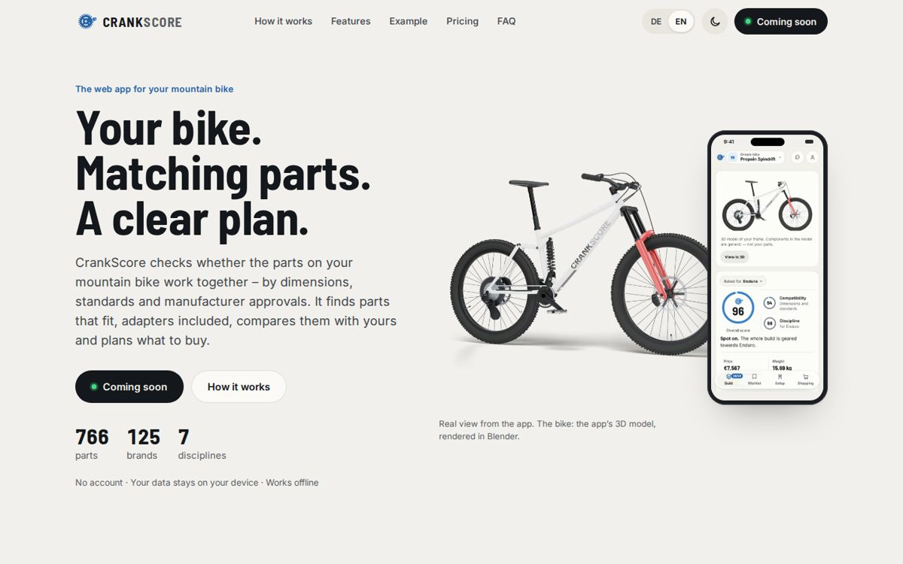
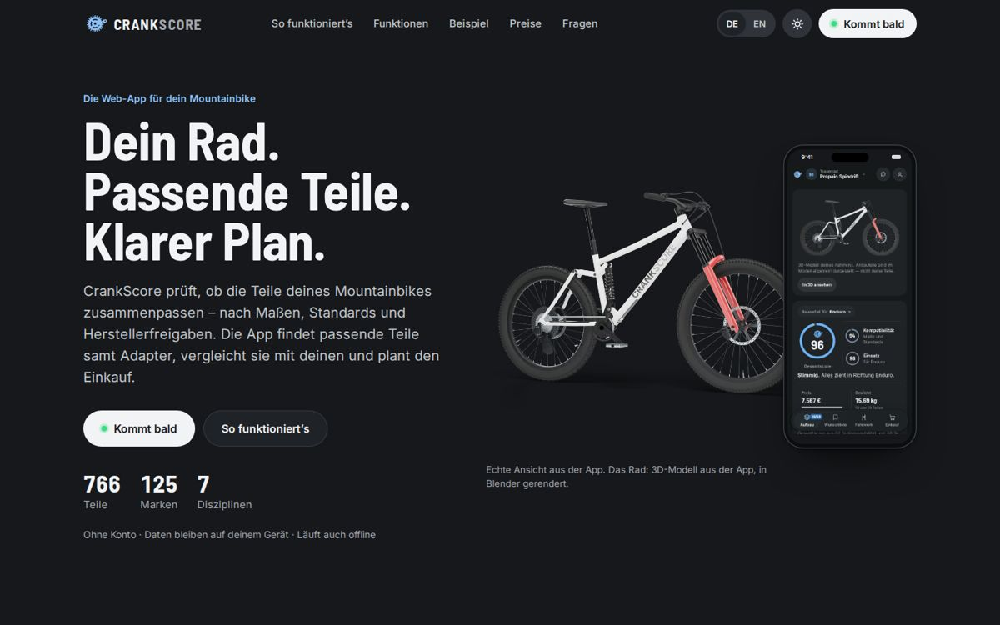
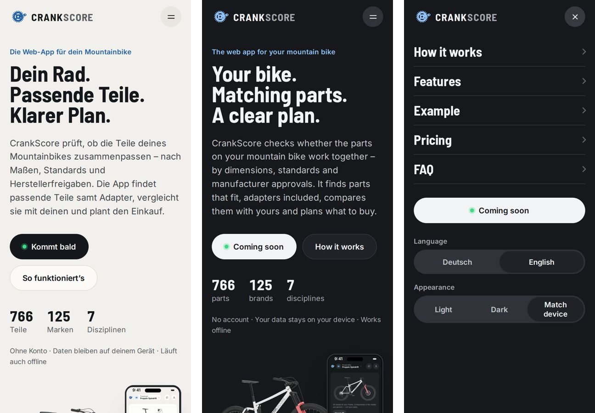
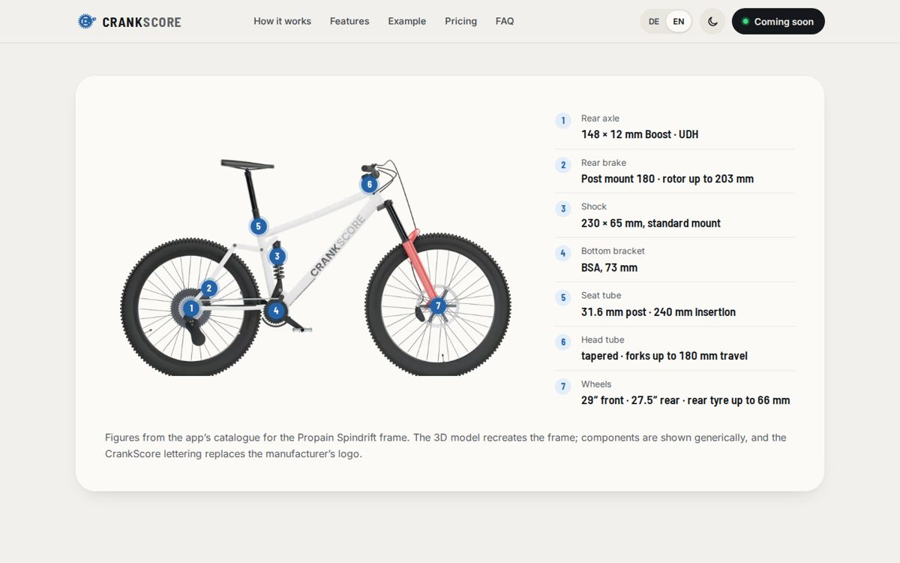
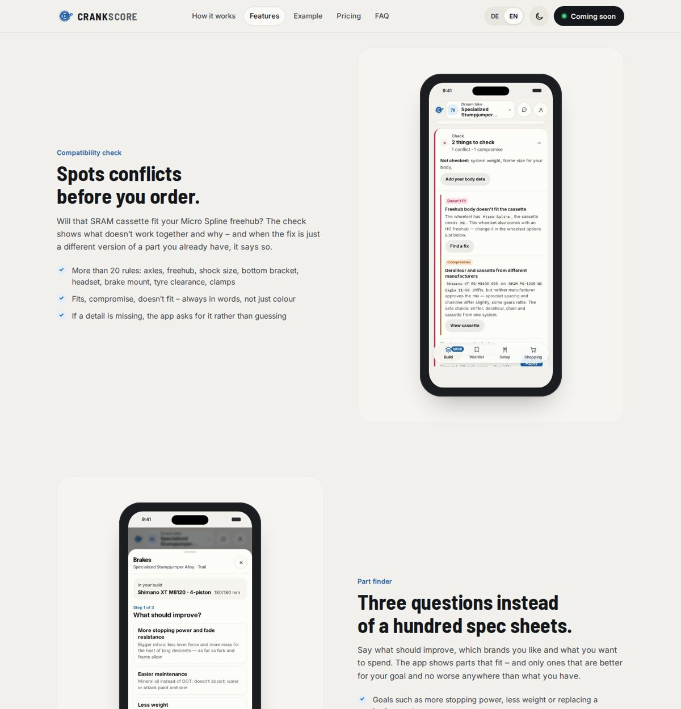
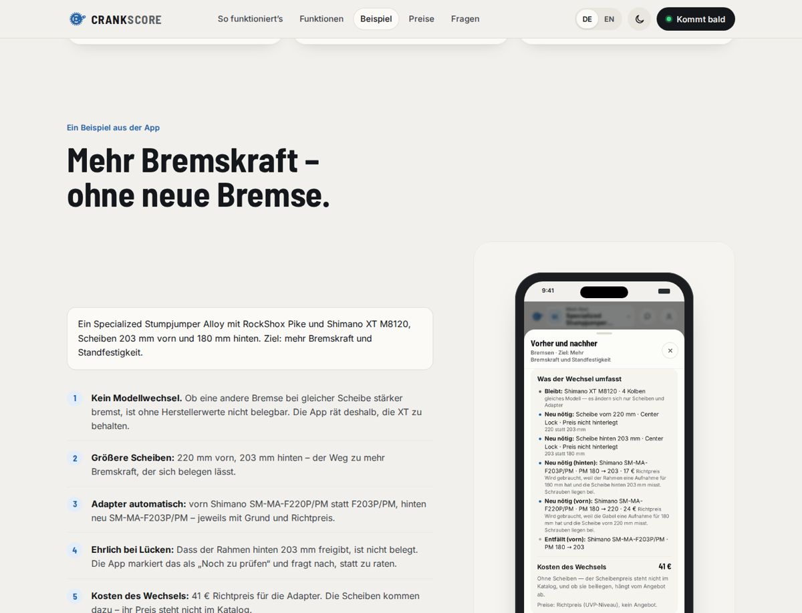
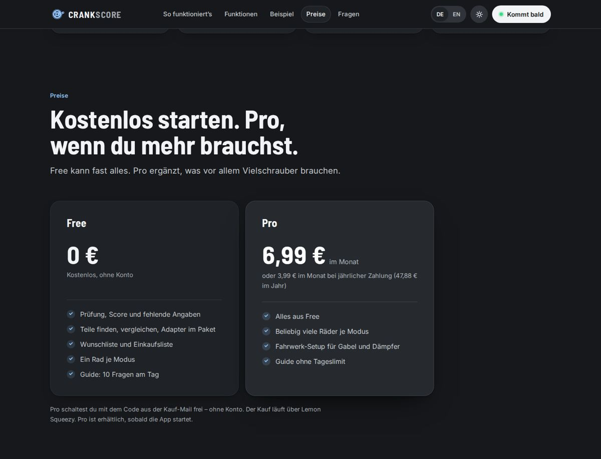
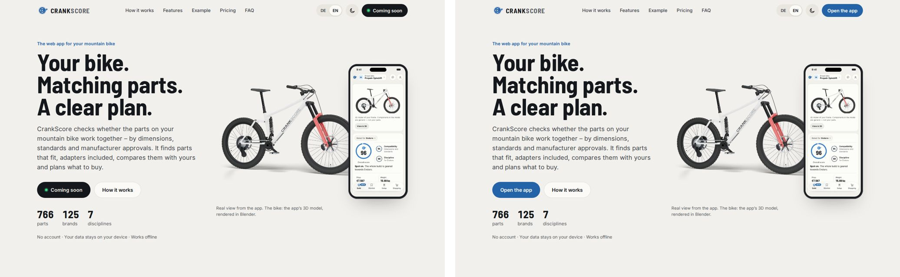
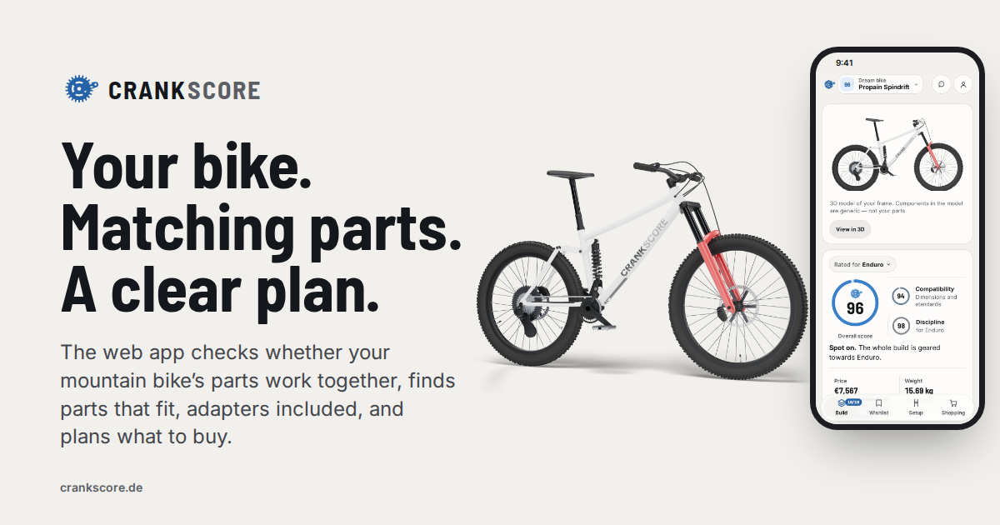

# Vorschau: crankscore.de für den gemeinsamen Release (WEB-RELEASE-001)

Liams Auftrag vom 11.10.2026: die Website vollständig auf den neuesten funktionierenden App-Stand bringen — gleiche
Designrichtung, Stahlblau, hochwertige Typografie, Radvisuals mit Blender, echte Aufnahmen, nur tatsächlich
funktionierende Funktionen.

- **Stand:** 11.10.2026, 17:33 Uhr, Repository `trostliam-hub/crankscore-web`, Branch `claude/website-release`, Commit `1927ca3`.
- **Veröffentlicht:** NEIN. crankscore.de zeigt weiter `main` `d251fc6`.
- **App-Stand der Aufnahmen:** Version 20261011-1532 (`dreambuild` `main` `333e2c9`), lokal gestartet.
- **Private Vorschau (nur Liam):** https://claude.ai/artifact/8ewLLk3UbBnUaAXsmixS48 — Release-Zustand mit „App öffnen“.
- **Bericht:** `CLAUDE-ANTWORTEN.md`, WEB-RELEASE-001.

## Einstieg, Desktop hell (Englisch, Standardsprache) und dunkel (Deutsch)

## Handy (390 px): Einstieg hell/dunkel und Menü

## Datenblatt: Rahmenwerte aus dem Katalog an der Blender-Seitenansicht

## Funktionen mit echten App-Aufnahmen

## Beispiel: Mehr Bremskraft ohne neue Bremse (Werte aus der App)

## Free und Pro, dunkel

## Release-Schalter: vor dem Release „Kommt bald“, danach „App öffnen“

## Vorschaubild für geteilte Links (og:image)

